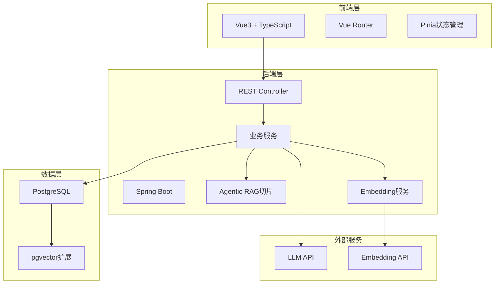
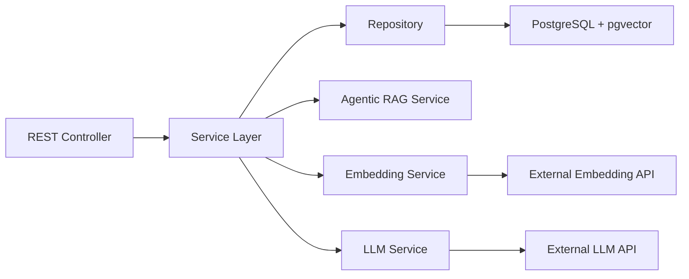
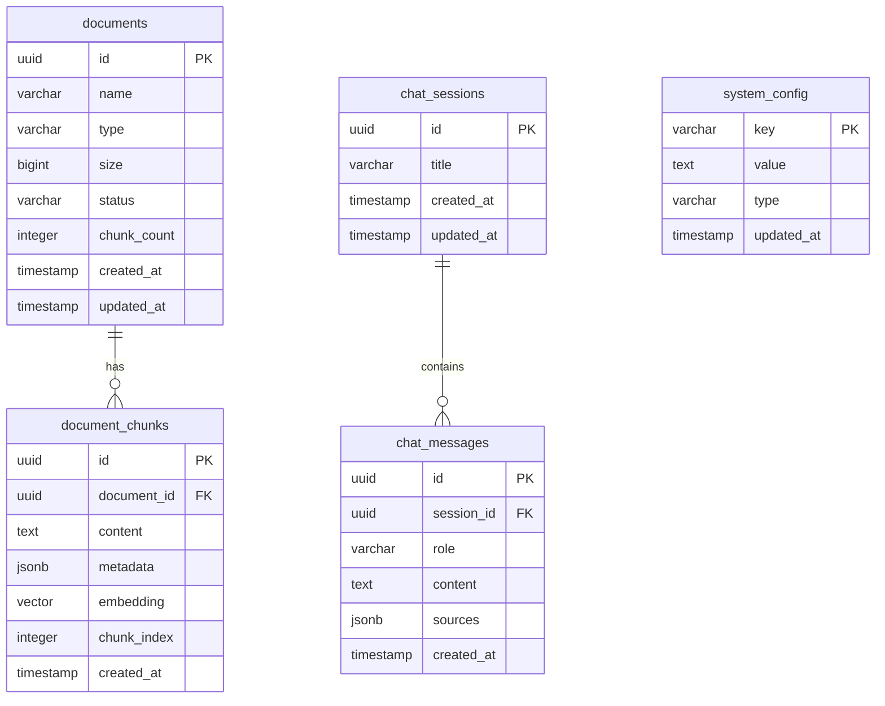

## 1. Architecture Design
分层架构设计，包含前端Vue3应用、后端Java Spring Boot服务、PostgreSQL + pgvector数据库。



## 2. Technology Description
- 前端：Vue3 + TypeScript + Vite + TailwindCSS + Pinia + Vue Router
- 初始化工具：Vite
- 后端：Java 17 + Spring Boot 3.2 + Spring Data JPA
- 数据库：PostgreSQL 15 + pgvector 0.6
- 构建工具：Maven

## 3. Route Definitions
| Route | Purpose |
|-------|---------|
| /documents | 文档管理页面 |
| /rag | RAG匹配页面 |
| /settings | 系统设置页面 |

## 4. API Definitions

### TypeScript Types
```typescript
interface Document {
  id: string;
  name: string;
  type: string;
  size: number;
  status: 'uploading' | 'processing' | 'completed' | 'failed';
  chunkCount: number;
  createdAt: string;
  updatedAt: string;
}

interface DocumentChunk {
  id: string;
  documentId: string;
  content: string;
  metadata: Record<string, any>;
  embedding?: number[];
  similarity?: number;
}

interface RagQuery {
  question: string;
  topK: number;
  similarityThreshold: number;
}

interface RagResponse {
  answer: string;
  sources: DocumentChunk[];
  processingTime: number;
}

interface ChatMessage {
  id: string;
  role: 'user' | 'assistant';
  content: string;
  sources?: DocumentChunk[];
  timestamp: string;
}

interface SystemConfig {
  embeddingModel: string;
  llmModel: string;
  chunkSize: number;
  chunkOverlap: number;
  temperature: number;
}
```

### API Endpoints
- `GET /api/documents` - 获取文档列表
- `POST /api/documents/upload` - 上传文档
- `DELETE /api/documents/{id}` - 删除文档
- `GET /api/documents/{id}/chunks` - 获取文档切片
- `POST /api/rag/query` - RAG查询
- `GET /api/rag/history` - 获取对话历史
- `GET /api/config` - 获取系统配置
- `PUT /api/config` - 更新系统配置

## 5. Server Architecture Diagram



## 6. Data Model

### 6.1 Data Model Definition


### 6.2 Data Definition Language

```sql
-- Enable pgvector extension
CREATE EXTENSION IF NOT EXISTS vector;

-- Documents table
CREATE TABLE documents (
    id UUID PRIMARY KEY DEFAULT gen_random_uuid(),
    name VARCHAR(255) NOT NULL,
    type VARCHAR(100) NOT NULL,
    size BIGINT NOT NULL,
    status VARCHAR(50) NOT NULL DEFAULT 'uploading',
    chunk_count INTEGER DEFAULT 0,
    created_at TIMESTAMP DEFAULT CURRENT_TIMESTAMP,
    updated_at TIMESTAMP DEFAULT CURRENT_TIMESTAMP
);

-- Document chunks table with vector
CREATE TABLE document_chunks (
    id UUID PRIMARY KEY DEFAULT gen_random_uuid(),
    document_id UUID NOT NULL REFERENCES documents(id) ON DELETE CASCADE,
    content TEXT NOT NULL,
    metadata JSONB DEFAULT '{}'::jsonb,
    embedding vector(1536),
    chunk_index INTEGER NOT NULL,
    created_at TIMESTAMP DEFAULT CURRENT_TIMESTAMP
);

-- Index for vector similarity search
CREATE INDEX ON document_chunks USING ivfflat (embedding vector_cosine_ops)
WITH (lists = 100);

-- Chat sessions table
CREATE TABLE chat_sessions (
    id UUID PRIMARY KEY DEFAULT gen_random_uuid(),
    title VARCHAR(255),
    created_at TIMESTAMP DEFAULT CURRENT_TIMESTAMP,
    updated_at TIMESTAMP DEFAULT CURRENT_TIMESTAMP
);

-- Chat messages table
CREATE TABLE chat_messages (
    id UUID PRIMARY KEY DEFAULT gen_random_uuid(),
    session_id UUID NOT NULL REFERENCES chat_sessions(id) ON DELETE CASCADE,
    role VARCHAR(50) NOT NULL,
    content TEXT NOT NULL,
    sources JSONB,
    created_at TIMESTAMP DEFAULT CURRENT_TIMESTAMP
);

-- System config table
CREATE TABLE system_config (
    key VARCHAR(100) PRIMARY KEY,
    value TEXT,
    type VARCHAR(50) NOT NULL,
    updated_at TIMESTAMP DEFAULT CURRENT_TIMESTAMP
);

-- Insert default config
INSERT INTO system_config (key, value, type) VALUES
('embedding_model', 'text-embedding-ada-002', 'string'),
('llm_model', 'gpt-3.5-turbo', 'string'),
('chunk_size', '1000', 'number'),
('chunk_overlap', '200', 'number'),
('temperature', '0.7', 'number');

-- Function for similarity search
CREATE OR REPLACE FUNCTION search_similar_chunks(
    query_embedding vector(1536),
    match_threshold float,
    match_count int
)
RETURNS TABLE (
    id UUID,
    document_id UUID,
    content TEXT,
    metadata JSONB,
    similarity float
)
LANGUAGE SQL STABLE
AS $$
    SELECT
        document_chunks.id,
        document_chunks.document_id,
        document_chunks.content,
        document_chunks.metadata,
        1 - (document_chunks.embedding <=> query_embedding) AS similarity
    FROM document_chunks
    WHERE 1 - (document_chunks.embedding <=> query_embedding) > match_threshold
    ORDER BY document_chunks.embedding <=> query_embedding
    LIMIT match_count;
$$;
```
