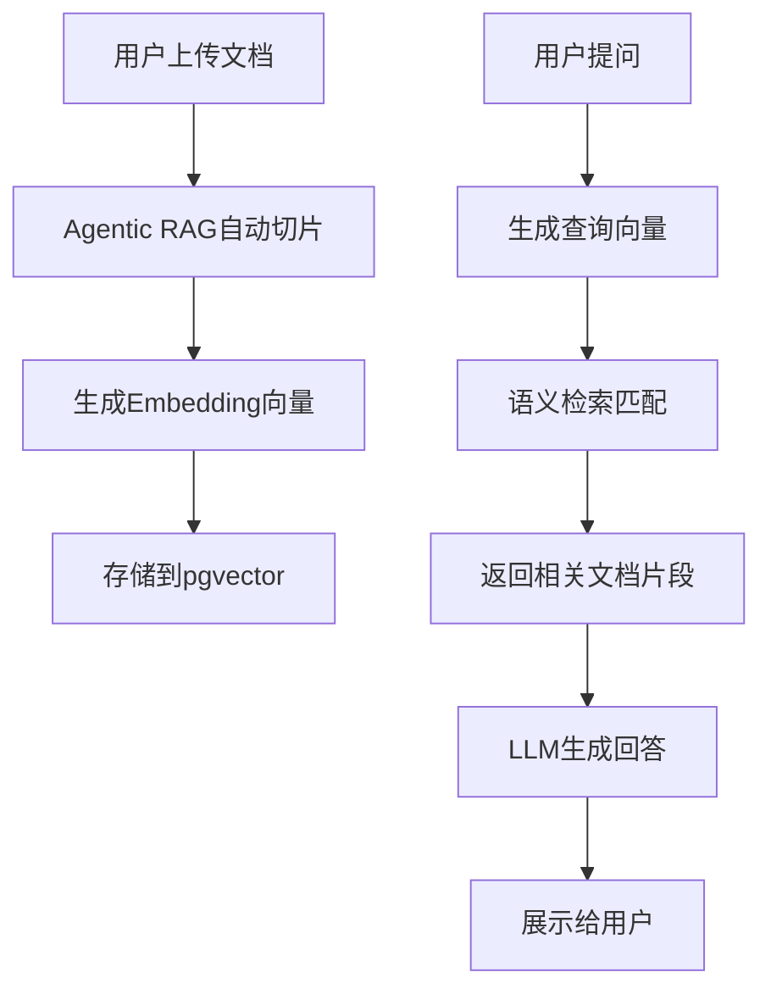

## 1. Product Overview
RAG管理系统是一个完整的文档管理和智能问答平台，支持文档导入、自动切片、向量化存储和语义检索功能。
- 解决传统文档管理和检索效率低下的问题，为企业提供智能化的知识管理解决方案
- 目标用户：企业知识管理团队、技术文档部门、客服支持团队

## 2. Core Features

### 2.1 User Roles
| Role | Registration Method | Core Permissions |
|------|---------------------|------------------|
| Admin | System initialization | 完整的系统管理权限 |

### 2.2 Feature Module
1. **文档管理页面**: 文档列表展示、上传、删除
2. **RAG匹配页面**: 智能问答、检索结果展示、相似度评分
3. **系统设置页面**: 向量模型配置、切片策略设置

### 2.3 Page Details
| Page Name | Module Name | Feature description |
|-----------|-------------|---------------------|
| 文档管理 | 文档列表 | 显示所有已上传文档，支持分页、搜索、排序 |
| 文档管理 | 文档上传 | 支持拖拽上传、文件选择、上传进度显示 |
| 文档管理 | 文档切片 | Agentic RAG自动切片、预览切片结果 |
| RAG匹配 | 提问输入 | 用户输入问题、选择检索策略 |
| RAG匹配 | 结果展示 | 显示检索到的文档片段、相似度、引用来源 |
| RAG匹配 | 对话历史 | 保存和查看历史对话记录 |
| 系统设置 | 模型配置 | 配置Embedding模型、LLM模型参数 |
| 系统设置 | 切片策略 | 设置切片大小、重叠窗口、分块规则 |

## 3. Core Process
用户上传文档 → 系统自动切片 → 向量化存储到pgvector → 用户提问 → 语义检索匹配 → 返回相关文档片段 → LLM生成回答

## 4. User Interface Design
### 4.1 Design Style
- 主色调：深蓝色(#1e40af) + 青色(#06b6d4)
- 按钮风格：圆角矩形、渐变背景、悬停动画
- 字体：Inter作为主字体，Roboto Mono作为代码字体
- 布局风格：卡片式布局、侧边栏导航
- 图标风格：简洁的线性图标

### 4.2 Page Design Overview
| Page Name | Module Name | UI Elements |
|-----------|-------------|-------------|
| 文档管理 | 文档列表 | 卡片式展示、状态标签、操作按钮、悬停效果 |
| 文档管理 | 上传区域 | 拖拽区域、进度条、文件预览 |
| RAG匹配 | 聊天界面 | 消息气泡、引用卡片、打字动画 |
| 系统设置 | 配置表单 | 分组表单、开关控件、保存反馈 |

### 4.3 Responsiveness
- Desktop-first设计，自适应平板和移动端
- 侧边栏在移动端可折叠
- 表格在小屏幕转为卡片展示

### 4.4 3D Scene Guidance
不适用3D场景
